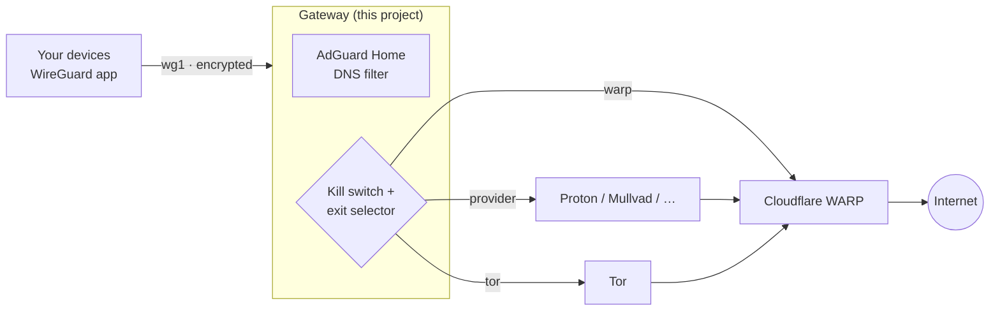

# Pi Privacy Gateway

A home privacy gateway for a Raspberry Pi (or any Linux box) in one `docker compose up`.
Your phone, laptop and PC connect to it with the official WireGuard app; it blocks ads and
trackers for all of them and sends their traffic out through the exit you choose, switchable
live from a dashboard:

| Exit | Speed* | Who sees what |
|---|---|---|
| **WARP** (default) | fast | Your ISP sees only encrypted traffic to Cloudflare. Cloudflare sees your IP and the sites you visit (not HTTPS content). |
| **Provider** (Proton, Mullvad, … via WireGuard) | fast | Runs *inside* WARP (double hop): Cloudflare sees your IP but only encrypted traffic to the provider; the provider sees the sites but never your IP. **No single company sees both.** |
| **Tor** | slow | Sites see a Tor exit relay. Tor runs inside WARP, so your ISP can't even see you use Tor. TCP only: UDP is blocked so nothing slips around Tor. |

<sub>*Measured on a Raspberry Pi 4 over a 5 GHz USB Wi-Fi uplink: ~70 Mbps via WARP, ~60 Mbps via the double hop.</sub>

All three modes are protected by a **kill switch**: if the chosen exit goes down, your devices lose
internet instead of leaking out through your normal connection.



## Features

- **WireGuard VPN server** for your devices, with preshared keys (post-quantum hardening) and QR codes —
  add, revoke and scan devices right from the dashboard, or with `pgw add-peer phone`
- **Three exit modes**, switchable for all devices at once from the dashboard, a CLI or the Windows tray app
- **Per-device exits**: e.g. the TV on fast WARP, your phone through the provider, one laptop always in Tor
- **Kill switch** that fails closed, armed before the VPN interface even comes up
- **Optional provider failover**: if the provider is down, its devices fall back to WARP instead of losing internet,
  and move back automatically when it recovers (`EXIT_FAILOVER=warp`, off by default)
- **Push alerts** to your phone via [ntfy](https://ntfy.sh) when an exit, Tor, DNS or the kill switch breaks, the
  CPU overheats, the power supply sags, the disk fills or the clock drifts — and when it recovers
- **30-day history** of throughput, CPU, temperature and power, stored locally in SQLite
- **Built-in leak test**: checks from your own browser that your exit IP, DNS resolver, IPv6 and WebRTC all
  go where the gateway says they should
- **AdGuard Home** DNS filtering with DNSSEC and encrypted (DoH) upstreams; in Tor mode DNS resolves through Tor too
- **Live dashboard**: your traffic layer by layer, live throughput per device and interface, Tor circuit with relay
  countries, live traceroute (through WARP *or* along your real ISP path), DNS query log, latency per layer, system
  health, and an estimated power draw and electricity cost on a Raspberry Pi 4. Nothing on the page loads from the
  internet (the leak test only contacts 1.1.1.1 when you press it).
- **Private by default**: your real IP, the DNS log, traceroute and all controls are only available to devices on the VPN,
  not to everyone on your Wi-Fi; device management can be limited further to your own computer (`ADMIN_IPS`).
  Every control is CSRF-protected.
- **Unprivileged container**: only the `NET_ADMIN` and `NET_RAW` capabilities, `no-new-privileges`; release images are
  multi-arch, signed with Sigstore and ship an SBOM and build provenance.
- **Self-healing**: tunnels, routing rules and the kill switch are re-checked every 5 seconds; quiet when nobody watches.

## Requirements

- Linux with WireGuard in the kernel (5.6+): Raspberry Pi OS, Ubuntu, Debian, …
- Docker with the compose plugin (`scripts/setup.sh` can install it)
- Port 53 free on the host (setup handles Ubuntu's systemd-resolved stub)
- A correct clock (Tor depends on it; see [extras/host](extras/host/README.md) for a Pi without a clock battery)

Tested on a Raspberry Pi 4 (arm64, Ubuntu 25.10); CI builds and tests on x86-64 and arm64.

## Easiest: the ready-made SD card image (Raspberry Pi 4/5)

1. From the [latest release](https://github.com/JMJAJ/pi-privacy-gateway/releases/latest), download and run the
   installer for your computer: `install-windows.cmd`, `install-mac.command` or `install-linux.sh`. It opens the
   official Raspberry Pi Imager (installing it if needed) with **Pi Privacy Gateway** in its OS list.
2. In Imager: *Choose Device* (Pi 4 or 5) → *Choose OS* → **Pi Privacy Gateway** → *Choose Storage* (your SD card,
   double-check it) → *Next* → answer **No** to OS customisation (it would replace the first-boot setup).
   Imager downloads the image and verifies its checksum while writing. For Wi-Fi instead of a cable, edit
   `network-config` on the card's boot partition afterwards.
3. Power on and wait about 15 minutes: the Pi installs everything on first boot.
4. Log in as `ubuntu` / `ubuntu` (you must pick a new password), then add your first device:
   `cd /opt/pi-privacy-gateway && sudo docker compose exec gateway pgw add-peer phone`.
   Progress and errors: `/var/log/pgw-firstboot.log`. The AdGuard login is in `/opt/pi-privacy-gateway/.env`.

The image is the official Ubuntu Server 24.04 LTS image (checksum-verified) plus two first-boot files
([image/](image)); [image/build.sh](image/build.sh) rebuilds it.

## Quick start (any Linux host)

```bash
git clone https://github.com/JMJAJ/pi-privacy-gateway.git
cd pi-privacy-gateway
sudo ./scripts/setup.sh          # checks the host, creates .env
sudo docker compose up -d --build
```

1. AdGuard Home comes pre-configured with the login from `.env` (`ADGUARD_USER` / `ADGUARD_PASSWORD`), admin
   interface on port 3000. (An existing AdGuard config is left alone.)
2. Add a device and scan the QR code with the WireGuard app:
   ```bash
   sudo docker compose exec gateway pgw add-peer phone
   ```
3. Turn the tunnel on in the app, then open the dashboard: **http://10.13.13.1/dashboard**.
   On a phone, use *Add to Home screen* to get an app icon.

## Everyday commands

```bash
docker compose exec gateway pgw add-peer laptop     # new device (prints a QR code)
docker compose exec gateway pgw qr laptop           # show its QR code again
docker compose exec gateway pgw list                # devices and when they last connected
docker compose exec gateway pgw remove-peer laptop  # revoke a device
docker compose exec gateway pgw mode tor            # switch exit for everyone: warp | provider | tor
docker compose exec gateway pgw device laptop tor   # this device only (back with: default)
docker compose exec gateway pgw status              # health check
```

Device configs (with their private keys) are stored in `data/gateway/peers/`. Keep `data/` private and backed up —
for example encrypt it to a key that lives on another computer, so the backup is useless to anyone who takes the Pi:

```bash
tar -czf - data .env | openssl cms -encrypt -aes256 -binary -outform DER backup.crt > pgw-backup.p7m
```

## Per-device exits

Every device follows the default exit unless you give it its own: pick it from the dropdown next to the device in
the dashboard, or `pgw device <name> warp|provider|tor|default`. The kill switch applies per device too — a device
set to Tor can never leave outside Tor, even while everyone else uses WARP. In Tor mode the device's DNS is also
resolved through Tor (a per-device AdGuard upstream).

## Alerts

Install the [ntfy](https://ntfy.sh) app, subscribe to a long random topic and set it in `.env`:

```bash
NTFY_URL=https://ntfy.sh/pgw-<20 random letters>
```

Each check must fail twice in a row before you're told, so short hiccups stay quiet; you get a second message when
it's fixed. Alerts that can't be sent (the internet is down) are queued and delivered later. Use your own ntfy
server if you prefer.

## Leak test

The dashboard's *Leak test* runs in your browser on the device you want to check: it compares the IP the internet
sees (IPv4 and IPv6) with the exit the gateway assigned to that device, checks that a unique DNS lookup arrived at
the gateway's own resolver, and lists the addresses WebRTC would reveal to a website.

## Adding a VPN provider (Proton, Mullvad, IVPN, …)

1. Download a **WireGuard** configuration from your provider. For Proton VPN:
   *Account → Downloads → WireGuard configuration*, platform *GNU/Linux*, NetShield off (AdGuard already filters),
   pick a server, *Create*, *Download*. The free plan works; it allows one connection at a time.
2. Save it as `data/gateway/provider.conf` and set `PROVIDER_NAME=Proton` in `.env`.
3. `docker compose up -d` and pick the new exit in the dashboard.

The provider tunnel runs inside WARP automatically (its MTU is adjusted to fit).

## Using it away from home

**Behind CGNAT** (many mobile and fibre ISPs: nothing from outside can reach your home) — use Tailscale as the
transport and this gateway as its exit node. Your phone then gets the same exit, kill switch, DNS filtering and
TTL masking anywhere; Tailscale sees which devices connect, not your traffic:

1. On the host: install [Tailscale](https://tailscale.com/download/linux), then
   `sudo tailscale up --advertise-exit-node --netfilter-mode=off --accept-dns=false`
   (`--netfilter-mode=off` leaves the firewall to the gateway's kill switch).
2. In the Tailscale admin console: the host → *Edit route settings* → tick **Use as exit node**; also *Disable key expiry*.
3. Set `TAILSCALE_EXIT=on` in `.env` and `docker compose up -d`.
4. On the phone: the Tailscale app, same account, *Exit node* → your gateway (turn the WireGuard app off:
   phones run one VPN at a time). The dashboard is at `http://<gateway's Tailscale IP>/dashboard`.

**With a public IP:**

Set `PUBLIC_ENDPOINT` in `.env` to a DynDNS name pointing at your home IP, forward UDP `WG_PORT` (51820)
on your router to the gateway, then add (or re-add) devices. Only WireGuard is exposed; it does not answer
anything without a valid key.

## Hiding that you use Tor (Snowflake bridge)

In Tor mode everything before the first Tor relay (your ISP, Cloudflare, your provider in Provider+Tor mode) can
tell the traffic is Tor. Pick *Bridge: Snowflake* on the dashboard's Tor card (or `pgw-exit tor-bridge snowflake`):
Tor then connects through Snowflake, which looks like a WebRTC video call to a volunteer proxy. It is slower and
needs 2–6 minutes to connect; if it can't, the gateway goes back to the normal connection by itself.

## How the kill switch works

The gateway inserts its own chains at the top of the firewall (it never edits your ufw/firewalld/Docker rules):

- `PIX_FWD`: traffic from VPN devices may only leave through the active exit (`wg0` WARP or `wg2` provider);
  everything else is rejected. In Tor mode, nothing is forwarded at all: TCP is redirected into Tor's transparent proxy.
- `PIX_IN`: lets VPN devices reach DNS and the dashboard on the gateway, even if the host firewall denies by default.
- It is armed *before* the VPN server starts, and re-armed automatically if anything removes it.
- Routing rule priorities are fixed (exit selector 95, WARP 98/99), so the order services start in can never send
  traffic to the wrong exit.

Mode switches wait until the new exit actually works. Until then the kill switch stays closed.

## Windows tray app

[`extras/windows`](extras/windows) has a small tray icon (green WARP, magenta provider, purple Tor, grey off) to toggle
the VPN and switch exits without opening the dashboard. Run `install-tasks.ps1` once as administrator. It creates
scheduled tasks so the tray can start/stop the tunnel without UAC prompts, with the task scripts stored in an
admin-only folder.

## Optional host tuning

[`extras/host`](extras/host/README.md): run a Pi headless and cooler (we measured 16.5 % → 0.9 % idle CPU and
−5 °C), keep the clock right for Tor, and fail over between two Wi-Fi radios.

## Troubleshooting

| Symptom | Cause / fix |
|---|---|
| No internet for a long time after power-on, in Tor mode | A Pi has no battery clock and Tor refuses a wrong time; in Tor mode DNS needs Tor. `setup.sh` adds DNS-free time servers and a boot-time HTTPS clock fix (`pgw-clockfix`). |
| `wg-quick: Permission denied` reading a config | Ubuntu's AppArmor profile only lets `wg-quick` read `/etc/wireguard`. Configs are kept there for this reason; don't move them. |
| AdGuard won't start: port 53 in use | systemd-resolved's stub listener. `scripts/setup.sh` can disable it. |
| Tor mode never connects | The clock is wrong. Check `timedatectl`; see [extras/host](extras/host/README.md). |
| Devices connect but have no internet | Check `pgw status`. In provider/Tor mode the kill switch blocks traffic until that exit works. |
| Dashboard shows "View only" | You opened it via the LAN address. Open it through the VPN (http://10.13.13.1) to switch exits. |

## How it compares

| | This project | [PiVPN](https://pivpn.io) | [wg-easy](https://github.com/wg-easy/wg-easy) | [Pi-hole](https://pi-hole.net) + VPN | [Algo](https://github.com/trailofbits/algo) |
|---|---|---|---|---|---|
| WireGuard server + QR codes | ✓ | ✓ | ✓ | separate | ✓ |
| Ad/tracker DNS filter | ✓ AdGuard | – | – | ✓ | basic |
| Hides your IP from sites | ✓ WARP / provider / Tor | – (home IP) | – (home IP) | – | ✓ (cloud VPS) |
| Double hop, no single company sees both ends | ✓ | – | – | – | – |
| Tor exit, per device | ✓ | – | – | – | – |
| Kill switch (fails closed) | ✓ | – | – | – | – |
| Live dashboard, history, leak test | ✓ | – | traffic only | DNS only | – |
| Push alerts | ✓ | – | – | – | – |
| Runs at home, no monthly cost | ✓ | ✓ | ✓ | ✓ | – (VPS) |

The others are good at what they do — PiVPN and wg-easy are the simplest way to reach your home network from outside.
This project is for the opposite direction: making your devices' traffic *leave* privately.

## Threat model

**Protects against**
- Your ISP, mobile carrier or a public Wi-Fi operator logging or selling the sites you visit (all they see is
  encrypted WireGuard to your home and encrypted traffic to Cloudflare).
- Sites and ad networks learning your home IP / location (provider or Tor mode).
- One VPN company holding both your identity and your browsing (provider mode: double hop).
- Leaks when an exit fails (kill switch), DNS leaks (all DNS forced through AdGuard), IPv6 leaks (blocked).
- Ads, trackers and malware domains on every device, including ones where you can't install a blocker (TVs, consoles).

**Does not protect against**
- Your browser identifying you: logins, cookies and fingerprinting. Use a privacy browser; for anonymity, Tor Browser.
- A compromised gateway host or someone with physical access to it (it holds all keys — encrypt your backups).
- Global adversaries correlating traffic timing; Cloudflare and your provider cooperating.
- Malware on your own devices.

## What each party can see

| Who | Can see | Cannot see |
|---|---|---|
| **Websites** | the exit IP (WARP, provider or a Tor exit), your browser fingerprint, your logins | your home IP, your ISP, your location by IP |
| **Your ISP** | encrypted WireGuard traffic to Cloudflare (so: that you use WARP), volume and timing | the sites, your DNS queries, which exit you picked, whether you use Tor |
| **Cloudflare (WARP)** | your home IP, volume; in WARP mode also the sites you visit | page content (HTTPS); in provider/Tor mode, the final destinations |
| **VPN provider** | the sites you visit, the WARP exit IP | your home IP |
| **Everyone on your Wi-Fi** | your devices' MAC addresses, their DHCP host names, Wi-Fi names a device probes for | anything inside the tunnel. The gateway dashboard hides SSID, BSSID, MACs, router address and listening ports from non-VPN viewers |
| **Services run by the gateway host itself** | the host's own traffic (updates, clock sync, push alerts) also leaves through WARP, IPv4 and IPv6; only the dashboard's "real ISP IP" check goes direct, to Cloudflare | - |

Things worth doing on your own devices (they are outside the gateway's reach):

- **Random MAC address per network.** Android: *Wi-Fi, network, Privacy, Use randomized MAC*. iOS: *Private Wi-Fi Address*.
  Windows (administrator): `netsh wlan set randomization enabled=yes interface="Wi-Fi"`, then
  `netsh wlan set profileparameter name="<SSID>" randomization=yes`. Your router will hand the device a new address once.
- **Don't let the PC probe for names.** Windows profiles set to "connect even if not broadcasting" announce that network's name
  everywhere: `netsh wlan set profileparameter name="<SSID>" nonBroadcast=no`.
- The gateway sets every device's outgoing TTL to 64, so sites can't tell Windows from a phone by it (WARP and
  provider modes; in Tor mode sites only ever see the exit relay's network stack).
- In provider mode the gateway resolves through Quad9 and Mullvad (no Cloudflare resolver, since Cloudflare
  already knows your IP through WARP), over the provider tunnel.
- **Disable Teredo** (`netsh interface teredo set state disabled`): it tunnels IPv6 around the VPN's routing and encodes your public IPv4 in the address.
- **Mesh/gaming VPNs** (Tailscale, Radmin, ZeroTier, ...) talk to their peers and coordination servers directly: pause them when you need the IP hidden.
- **Host name**: a device's DHCP name (often your username) is visible on the LAN; choose a neutral one.

## Security notes & limits

- The gateway container is **not privileged**, but it has `NET_ADMIN` on the host's network stack (it has to create
  interfaces, routes and firewall rules). Treat the host as part of your security boundary, and keep it updated.
- The dashboard and AdGuard admin are only reachable through the VPN; nothing is exposed to the internet except the
  WireGuard port, which ignores anything without a valid key.
- **WARP is not anonymity.** Cloudflare sees your IP. Use the provider or Tor mode when that matters.
- **Your browser identifies you more than your IP does** (cookies, logins, fingerprinting). Pair this with a
  privacy-focused browser; for real anonymity use Tor Browser.
- Power figures are an estimate (a Raspberry Pi 4 has no power sensor).

## Development

```bash
sudo bash tests/smoke.sh   # builds the image and runs ~50 checks in an isolated network namespace
```

The smoke test runs the container unprivileged exactly like `docker-compose.yml` does, uses offline stand-ins for
WARP and the provider (`PGW_TEST=1`) and never touches the host's own network. It covers the kill switch, per-device
exits, failover, fail-closed Tor mode and the dashboard API (including CSRF and input validation).

Releases (`v*` tags) publish signed multi-arch images to `ghcr.io/jmjaj/pi-privacy-gateway`. Verify one with:

```bash
cosign verify ghcr.io/jmjaj/pi-privacy-gateway:latest \
  --certificate-identity-regexp 'https://github.com/JMJAJ/pi-privacy-gateway/' \
  --certificate-oidc-issuer https://token.actions.githubusercontent.com
```

## License

MIT. Uses [wgcf](https://github.com/ViRb3/wgcf) to register WARP, [AdGuard Home](https://github.com/AdguardTeam/AdGuardHome),
[Tor](https://www.torproject.org/) and [WireGuard](https://www.wireguard.com/).
